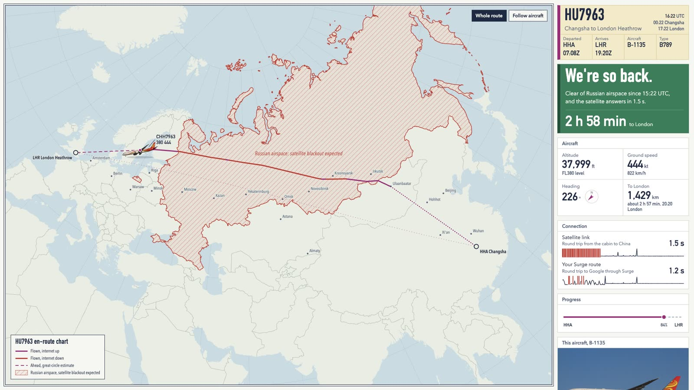
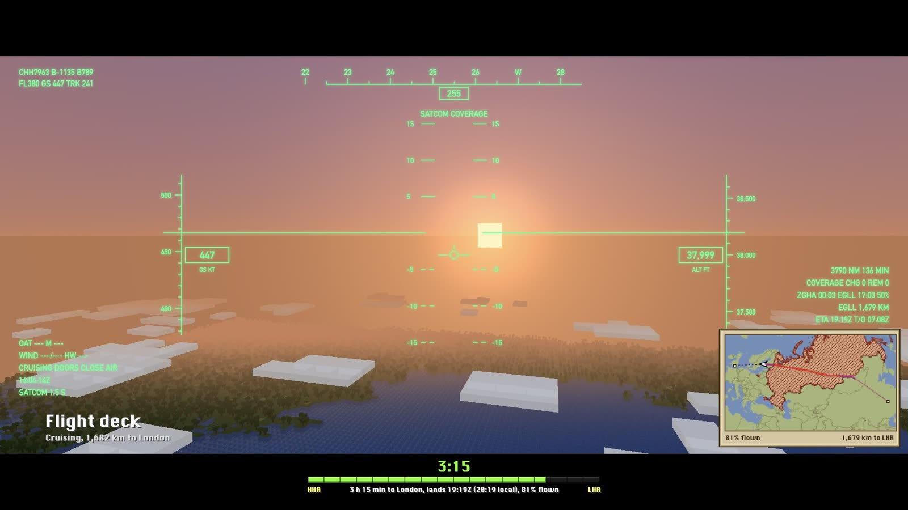
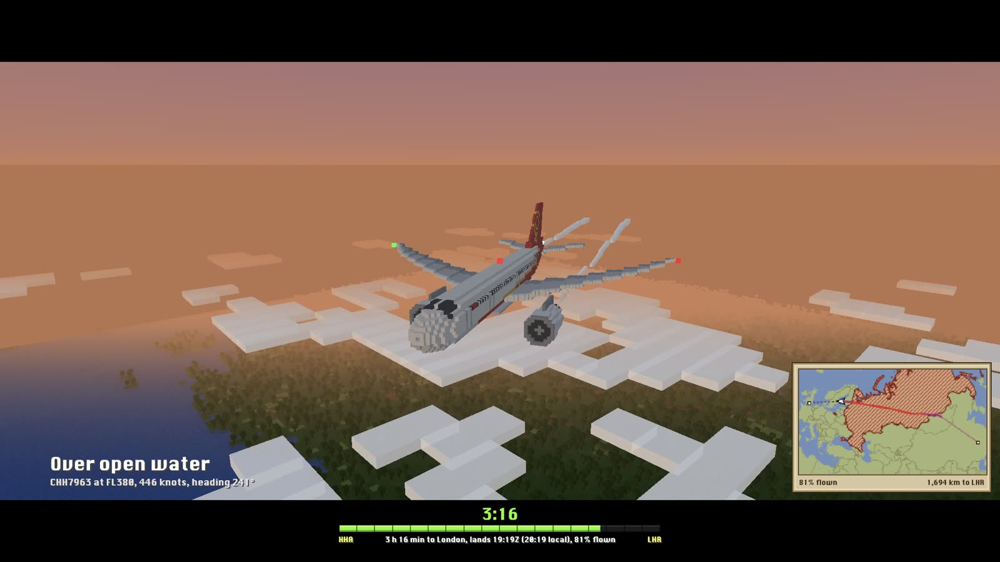
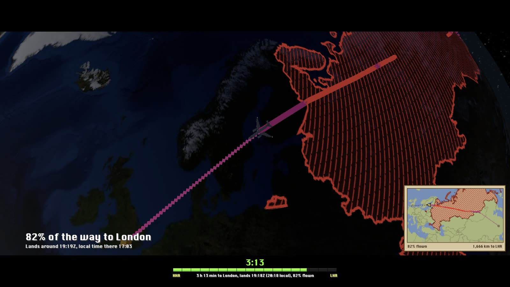
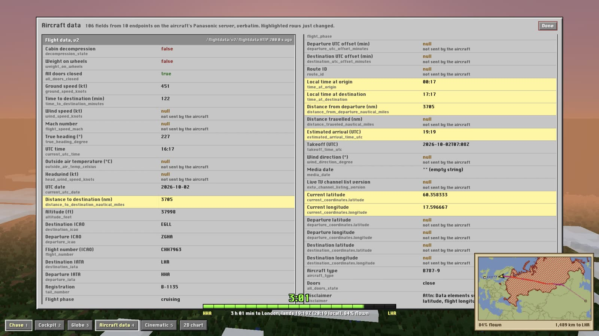
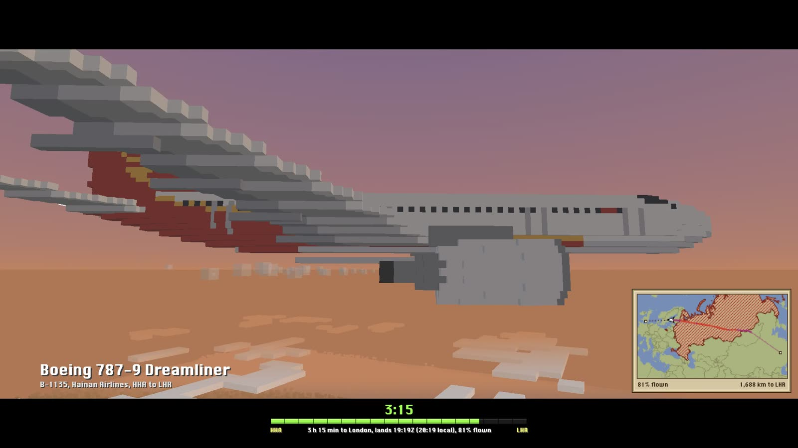

# inflight-kit

Things built on one long flight (HU7963, Changsha to London, Boeing 787-9 B-1135):

- **`share/`**: share one paid in-flight Wi-Fi connection with another phone, wirelessly, through an Android phone acting as a little router.
- **`tracker/`**: follow the flight live from the aircraft's own data. A 2D en-route chart, and a Minecraft-style 3D view with a voxel 787, real terrain, a cockpit HUD and a cinematic camera. It keeps working when the satellite link drops.


## The tracker

Many airlines run Panasonic eXConnect. Its on-board server answers on the cabin Wi-Fi with no login, at `services.inflightpanasonic.aero/inflight/services/flightdata/v2/flightdata`: position, altitude, ground speed, heading, origin, destination, minutes to go and more. The server is on the aircraft, so it keeps answering when the satellite link is down. The tracker polls it every 3 seconds, keeps a per-flight log and serves two pages from your laptop.

```sh
cd tracker
python3 tools/prefetch_tiles.py LHR PEK   # on the ground, before the flight: 3D terrain for the route
python3 server.py                         # in the air, on the cabin Wi-Fi
open http://127.0.0.1:7963                # 2D chart
open http://127.0.0.1:7963/3d/            # 3D view
```

The server finds the on-board server through the cabin's own DNS and reads the route from the feed, so there's nothing to configure per flight. Needs macOS (it pins its connectivity probe to `en0`) and Python 3.9+. No packages.

No plane handy? Replay a recorded flight, or fly a fake one:

```sh
python3 tools/mock_pax.py --from EGLL --to ZBAA --callsign CHH492 --speed 30
python3 server.py --pax 127.0.0.1:8099
```

### 2D chart

An aeronautical-chart-style map with the route, the flown track coloured by whether the internet was up, Russian airspace hatched as the expected satellite blackout zone, and a status strip that flips between "Online, for now", "It's so over." and "We're so back." There's also a desktop notification for that last one.



### 3D view

| Key | View |
|---|---|
| `1` | Chase: drag to orbit the aircraft, scroll to zoom |
| `2` | Cockpit, with a HUD of every number the aircraft sends |
| `3` | Globe |
| `4` | Every field from every on-board endpoint, verbatim, with changes highlighted |
| `5` | Cinematic: a loop of seven shots with captions from live data |
| `C` | Clouds on or off |
| `F3` | Debug screen |

- **The world is built from real terrain.** Elevation sets each block's height. Satellite colour picks the block type (grass tinted by biome, taiga with spruce trees, sand, stone, snow, water) and tints it.
- **Blocks shrink on the way down:** 2 km at cruise, 1 km in the descent, 500 m on final approach.
- **The time remaining is an XP bar.** A pixel-art minimap shows the whole route.

| | |
|---|---|
|  |  |
|  |  |

### Things the feed doesn't tell you

- **The arrival time field is mislabelled.** `estimated_arrival_time_utc` was destination local time, not UTC, an hour off during British Summer Time. `time_to_destination_minutes` is what the seatback screen shows, and it matches the distance left. The tracker uses that.
- **Two distance fields are wrong.** `distance_to_destination_nautical_miles` and `distance_from_departure_nautical_miles` didn't match the position at all.
- **The cabin network fakes connectivity.** A satellite accelerator answers TCP handshakes in a few milliseconds whether or not the satellite is up, and the portal fakes the usual connectivity-check URLs. "Online" here means a real, cache-busted HTTP round trip (about 1.7 s on a geostationary link).
- **Cabin Wi-Fi on Chinese airlines routes through China.** The probe uses hosts that are reachable from there.

## Sharing the Wi-Fi

On this flight, internet was sold per device. A Mac can't re-share Wi-Fi over Wi-Fi, an iPhone's Personal Hotspot only shares cellular, and the cabin network blocks devices from talking to each other. What worked was a Pixel plugged into the Mac by USB:

```
cabin Wi-Fi -> Mac -> USB (gnirehtet) -> Pixel -> SOCKS5/HTTP proxy -> Pixel hotspot -> other phone
```

[`share/README.md`](share/README.md) has the full setup, the carrier hotspot check that got in the way, and how to undo it. Check your Wi-Fi plan's terms before you share it.

## Show reels

[`showreel/`](showreel/README.md) has the script that turns captured frames into 1080p H.264 clips, and notes on how they were recorded by driving a browser.



## Credits

Third-party code, data and photos are listed in [ATTRIBUTION.md](ATTRIBUTION.md), with their licenses. The code here is MIT.
